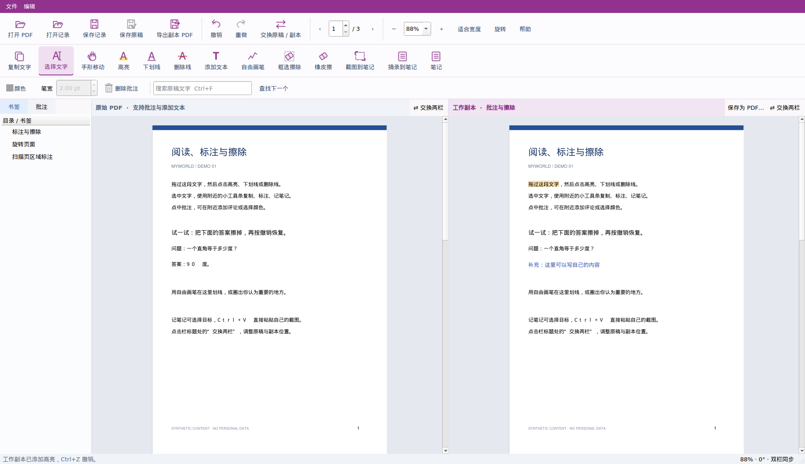

# myworld

[English](README.en.md) · [使用手册](docs/USER_GUIDE.md)

**一边保留原文，一边把阅读变成自己的世界。**

myworld 是面向 Windows 的本地双栏 PDF 阅读、标注、擦除与图文笔记工具。原始 PDF 和工作副本同步显示；你可以在副本中擦除、补充文字，同时保留原文作对照。

由真实阅读需求驱动，通过人与 AI 协作逐步开发。前身为 StudyPDF；自 0.6.1 起以 **myworld** 名称开放源码，当前版本为 **0.6.2**，原有 `.pdfwork` 继续兼容。

## 下载与启动

普通用户请打开本仓库的 **Releases**，在 `v0.6.2` 的 **Assets** 中下载：

**`myworld_0.6.2_Windows_x64.zip`**

完整解压到新文件夹，双击 **`Start_myworld.bat`**。Windows 完整包包含运行环境，无需安装 Python、福昕或联网下载依赖。支持 Windows 10/11 x64。

GitHub 自动生成的 **Source code (zip)** 只包含源码；开发者使用方式见下文。若下载的是源码，不含 `runtime` 文件夹，需要自行安装依赖。

## 可以做什么

| 功能 | 使用方式 |
| --- | --- |
| 双栏同步 | 原稿与工作副本同步页码、连续滚动、缩放和旋转，可左右交换 |
| 基本批注 | 两栏均可高亮、下划线、删除线、自由画笔；选文后出现操作小栏 |
| 添加文本 | 在页上输入文字，设置字体、字号和颜色，移动或调整文本框 |
| 擦除与导出 | 工作副本支持矩形、画笔擦除；导出新 PDF 时实际移除区域内容 |
| 常驻评论 | 为文字标注写评论；卡片可移动、继续编辑、半透明显示及同色指向 |
| 图文笔记 | 选文摘录到指定笔记、页面截图、Ctrl+V 粘贴图片，支持多篇笔记 |
| 图片调整 | 拖动笔记图片右下角或输入宽度，保持比例，支持撤销 |
| 工作记录 | `.pdfwork` 保存编辑、笔记与图片，打开对应 PDF 自动加载匹配记录 |
| 撤销与重做 | PDF 工作层支持撤销/重做；笔记与文字输入使用各自的编辑撤销 |
| 原稿保存 | “保存原稿”只写回原稿栏修改，并保留上一版备份 |

高亮使用混合方式保持原文字清晰。中文字体取自本机可用字体；未捆绑微软雅黑、宋体等商业字体文件。

## 第一次使用

1. 把本地 PDF 拖到窗口两栏、侧栏或笔记区域即可打开；也可使用“打开 PDF”或包内 `demo.pdf`。
2. 左侧保留原稿，右侧按需要高亮、划线、擦除或添加文字。
3. 选择文字后，使用附近的小栏进行批注、复制或“记笔记”。
4. 按 **F8** 打开阅读笔记；截图可在笔记中 **Ctrl+V** 粘贴。
5. 工作记录会在编辑后自动保存；**Ctrl+S** 手动保存 `.pdfwork`。
6. 点击工作副本标题旁 **“保存为 PDF…”** 或顶部 **“导出副本 PDF”**（Ctrl+E）得到新 PDF；需要把原稿栏修改写回时选择 **“保存原稿”**。

建议把 `课程.pdf` 与 `课程.pdfwork` 放在同一文件夹。移动资料时一起复制；源 PDF 内容改变后，工具会校验并阻止不匹配记录静默套用。

## 0.6.2：拖放打开与工作副本保存

- 本地 PDF 可拖到两栏、侧栏或笔记区域打开，空白窗口也支持。多个文件拖入时只打开第一个有效 PDF。
- 顶部“导出副本 PDF”和工作副本标题旁“保存为 PDF…”是同一个入口，左右交换后仍跟随工作副本。
- 生成标准 PDF，保留批注、评论、添加文字及擦除结果；可用福昕等阅读器直接打开，无需 myworld。
- 导出前尝试保存 .pdfwork。记录保存失败时仍允许导出 PDF，并提示另存工作记录。
- 图文笔记、分层编辑历史与卡片位置仍在 .pdfwork；导出的 PDF 不含笔记栏。要继续分层编辑，保留原 PDF 与 .pdfwork。

## 三种保存

| 操作 | 保存内容 | 原始 PDF |
| --- | --- | --- |
| 保存记录 | 编辑历史、图文笔记、卡片位置、阅读状态 | 不改动 |
| 保存原稿 | 原稿栏的新增文字与批注 | 写回；保留一份 `.studypdf.bak` 滚动备份 |
| 保存为 PDF / 导出副本 PDF | 先尝试保存工作记录，再生成当前副本的标准 PDF | 不覆盖原始 PDF |

导出擦除不可从导出成品恢复，请保留源文件和工作记录。复杂矢量图形与擦除区域相交时可能被整体移除；扫描页缺少 OCR 时不能像文字 PDF 那样选文搜索。

## 文档

- [完整使用手册与快捷键](docs/USER_GUIDE.md)
- [GitHub 从建仓库到发布下载包](docs/PUBLISH_TO_GITHUB.md)
- [开发、测试与打包](docs/DEVELOPMENT.md)
- [架构与存档兼容性](docs/ARCHITECTURE.md)
- [版本记录](CHANGELOG.md)
- [贡献指南](CONTRIBUTING.md)
- [安全问题](SECURITY.md)
- [第三方依赖与对应源码](THIRD_PARTY_NOTICES.md)

## 从源码运行

需要 Python 3.12（推荐 x64）：

~~~powershell
py -3.12 -m venv .venv
.\.venv\Scripts\python.exe -m pip install -r requirements.txt
.\.venv\Scripts\python.exe app.py
~~~

Windows 完整包用户不需要执行这些命令。Python 依赖固定为 PyMuPDF 1.26.6、PySide6-Essentials 6.8.3；此次改名未升级 PDF/Qt 引擎。

## 验证范围与现有限制

本次回归和新增检查在 Linux Qt 离屏环境执行，详见 [发布说明](docs/releases/v0.6.2.md)。GitHub Actions 配置随源码提供，只有实际运行成功后才代表线上 CI 通过。

尚未在 Windows 实机完成系统性验证。当前版本适合作为公开预览版，欢迎反馈可复现的问题。未实现 OCR、多文档标签、原 PDF 任意正文重排、电子签名和协作云同步。

应用不包含上传、遥测或联网分析功能。运行完整包与处理 PDF、笔记均在本机进行；从源码安装依赖或下载发行包需要联网。日志与导出的笔记可能包含文件路径或你输入的内容，反馈问题前请自行检查。

## 开源许可

应用源码使用 **GNU Affero General Public License v3.0 only（AGPL-3.0-only）**，全文见 [LICENSE](LICENSE)。欢迎使用、学习、修改和在遵守许可的前提下分享。依赖保留各自的版权与许可，见 [第三方说明](THIRD_PARTY_NOTICES.md)。

myworld 是独立项目，与福昕、ima、微软等公司无隶属、赞助或官方合作关系。PDF 图标与界面代码为项目自有实现，不打包其商标或产品素材。
